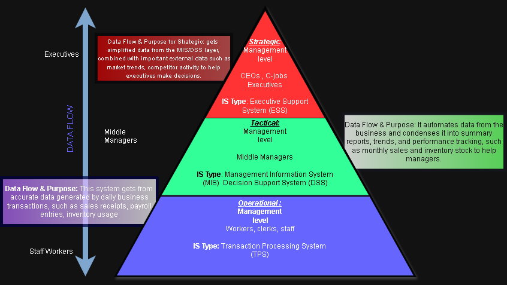

#Author: Lemuel waye Otoo-Biney
------------------------------------------------------------------------------------------------------

------------------------------------------------------------------------------------------------------

1.)IT Infrastructure Diagram:
------------------------------
-Shows the actual physical assests deployed by the organisation.
-These assests includes servers, componets, work stations/stalls, cables, storage devices and more.
-This also shows the device model, version and current device locations 

2.) IT Landscape Diagram:
--------------------------
-Provides a high level overview of assest type with lesser details than the infrastructure Diagram. 
-It does not show the name of a assest, it instead shows the logical systems and their relationships.
-For example a server has my types like a database or payment server.

3.) IT Architecture Diagram:
----------------------------
-It outlines and displays the concepts, principles,norms, standards and guidelines.
-This diagram acts a blueprint for the structure, rules and principles which the IT Landscape must follow.
-It is a standard for all technology to go through an architecture layer, with specific requirements and 
 how the systems fit with each other while also being secure to help the business.

